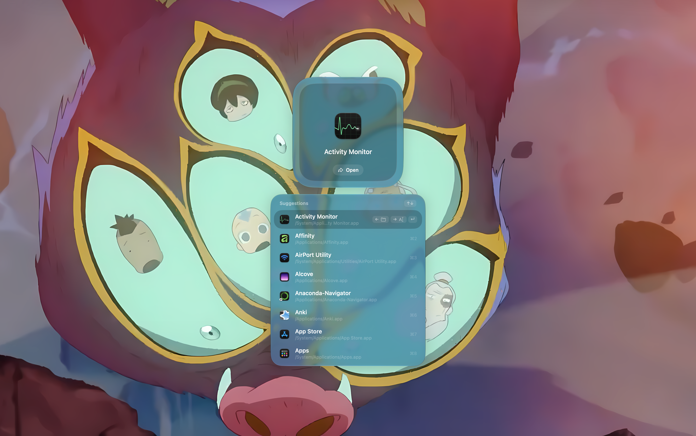

# ray
A lightweight, keyboard-driven launcher for macOS

   

To be honest I've messed up the version number scheme, all of these should be version 0.x but I don't really feel its a massive issue as of late.

## More about ray
Ray is a modal launcher, similar to and inspired by Tuna and Raycast that sort of embraces Apple's liquid glass concept without holding it back. Raycast was one of the best apps that improved my experience with my Mac and since it stopped working I decided to build my own.

## How ray was made
Ray is a fully SwiftUI native app and such is only supported for macOS. ray also uses code from other applications:
- From Math.js, a CAS Engine is used to create a decent calculator that can solve algebra and run more complex functions

## How to install ray
Version 1.3+ requirements:
- macOS Sequoia and later (15.6+)

Version 1.2- requirements:
- macOS Tahoe and later (26+)

To install it:
- Check out the [latest release](https://github.com/dylankaru/ray/releases/latest) and download the DMG installer. Then just run and follow its instructions to start using ray.

> Note: since ray isn't notarised, macOS Gatekeeper may warn you on the first launch, so you'll have to right-click the app and press `Open` to bypass it, and if that doesn't work you'll have to go to `System Settings`, then `Privacy and Security`, scroll down to security and press `Open Anyway`

# How to use ray
Ray has an in-built onboarding to help new users learn the flow, but if it isn't clear:
- `⌥ + Space` is the default ray open keybind
- Searching anything in ray when the launcher shows up
- Navigate the map using arrow keys or `⌘ + (a number up to 9)`
- Cycle through different modes using `Tab`

Custom features:
- Emoji Dictionary
- Camera
- Keybind Other Apps (configurable in settings)
- Notes (mode)
- CAS Calculator (mode)
